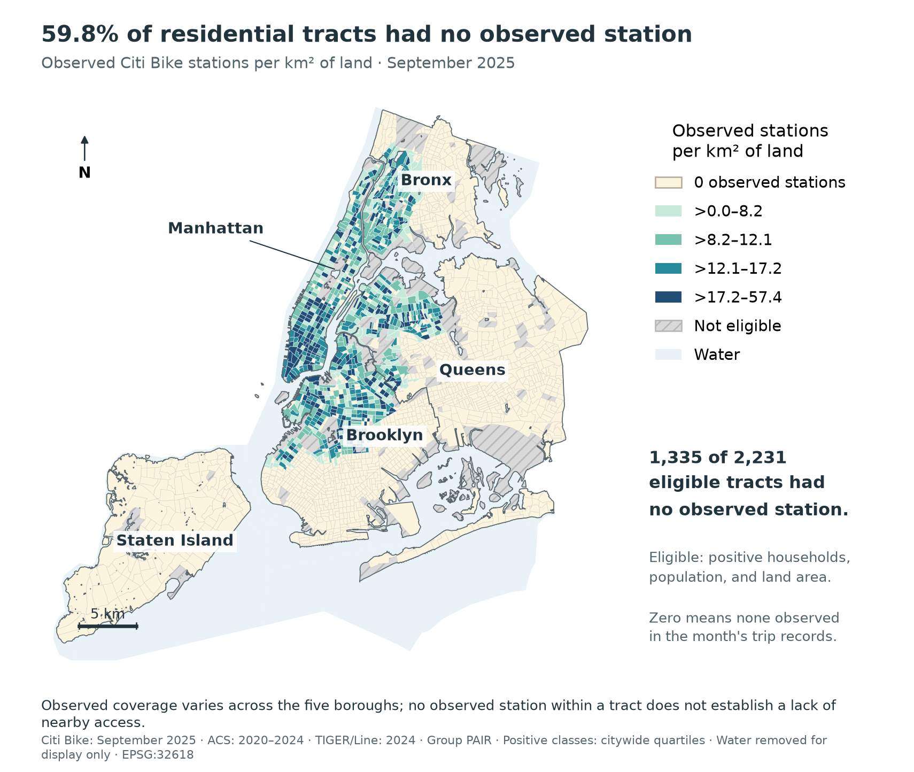
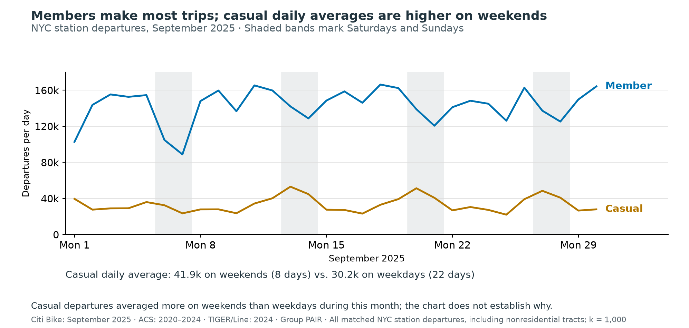

<!-- Edit this file, then run: .venv/bin/python -m analysis.report
Use # for a new page title, ## for section headings, and blank lines between paragraphs.
Keep the three page titles and generated-table markers to preserve the report layout.
Tables and images load existing analysis outputs; prose and numbers in prose are yours to edit.
-->
# Citi Bike coverage and neighborhood mobility

**Timothy Phan and Ethan Deng · Group PAIR · Midterm progress report**
https://github.com/EthanWD1/cp101-citibike-equity

## Research question and current state

How did observed Citi Bike station density and usage vary with median household income and the share of households without a vehicle across New York City census tracts in September 2025, citywide and within each borough? The geography, month, demographic variables, and descriptive approach remain as proposed. The audience is NYC transportation planners and community groups assessing where observed coverage merits closer review.

So far, we have completed full-month acquisition, documented cleaning, point-to-tract spatial join, citywide/borough comparisons, one map and five charts, and a reproducible Python workflow. Static figures are the midterm milestone. Animated maps, the webpage, and operational/boundary sensitivity checks remain final-project work; no historical station inventory has been replaced by a current feed.

## Data and documented cleaning

All six original trip CSVs contain 5,287,447 rows. We have additionally utilized ACS 2020–2024 five-year tables B19013 for income, B08201 for households and vehicle availability, and B01003 for population to contextualize each tract, as well as 2024 TIGER/Line data for boundaries and land area. ACS data were obtained from official table-based text files without an API key. Raw files, download dates, URLs, and SHA-256 checksums are retained.

The sequential trip filters remove 931 starts outside September; missing ride IDs, duplicate IDs, and invalid start timestamps; each affect 0, 0, and 0 rows, respectively. Of 5,286,516 retained starts, 2,118 lack both a start station ID and usable coordinates and cannot enter station usage. Missing destination IDs affect 12,865 retained trips but do not remove their valid departures.

<!-- table: cleaning -->

The spatial join assigns 2,212 of 2,269 located station IDs to NYC with 57 station locations outside/unmatched to NYC remain audited. There are 0 boundary ties. Residential comparisons retain 2,231 of 2,327 NYC tracts; 96 fail the positive-household/population/land-area rule. Another 32 eligible tracts lack income data and remain mapped but are excluded only from income comparisons. The 13 upper-bound income estimates are flagged; 272 eligible tracts have income MOEs above half their estimate.

## Methods and validation

1. Parse local timestamps, keep September starts, and deduplicate ride IDs across files using a disk-backed index. 2. Infer station locations from both endpoints by modal coordinate pair, preserving string IDs. 3. Project to **EPSG:32618 (meters)**, spatially intersect stations with tracts, and merge ACS by eleven-digit GEOID. 4. Aggregate starts by their station's tract; calculate stations/land km², stations/10,000 residents, and departures/observed station. 5. Compare unweighted tracts using fixed citywide income and no-vehicle-share quartiles within every borough; report descriptive Spearman correlations. Coverage includes zeros; usage excludes zero-station tracts. Land area is TIGER ALAND/1,000,000, excluding water from the denominator.

All 15 reconciliation checks pass. The 5,284,398 assigned NYC departures reconcile across stations, tracts, boroughs, and dates; 196,150 are in ineligible residential-comparison tracts. The notebook regenerates outputs from raw inputs using relative paths.

# Early results: coverage across all five boroughs

Observed coverage is uneven: 1,335 of 2,231 eligible tracts (59.8%) have no observed station. The share is 11.6% in Manhattan, 72.9% in Queens, and 100% in Staten Island. These are observations from trip records, not a claim that residents cannot reach stations in adjacent tracts.

<!-- table: boroughs -->

*Departures include all assigned NYC stations, including tracts outside the residential comparison. Density medians and zero percentages use eligible tracts only. Figure 01 removes 2024 Census water polygons for display; original tracts, station assignments, and ALAND denominators remain unchanged. Full-size PNGs accompany this report.*

# Early results, limitations, and plan to finish

The citywide income–density correlation is nearly flat (ρ=0.05), but borough patterns differ: Bronx -0.53, Brooklyn 0.30, Manhattan 0.05, and Queens -0.13. No-vehicle household share is more positively associated with density citywide (ρ=0.59). Its highest quartile has 21.9% zero-station tracts, versus 95.5% in its lowest quartile. The borough differences caution against a single citywide income story.

Among tracts with stations, median September departures per observed station rise from 496 in the lowest income quartile to 4,068 in the highest. This conditional comparison describes activity where stations were observed, not demand in unserved tracts or trips made by residents. Casual departures averaged 41,897/day on weekends versus 30,249 on weekdays this month; no causal explanation is established.

## Interpretation and remaining risks

ACS estimates cover five years and have sampling uncertainty; they do not describe individual riders. Tract boundaries, jobs, transit, land use, and partial-month operation can affect the patterns. The one flagged station location spans 291 m; its modal pair accounts for 383 of 389 endpoint observations, and both locations fall in the same tract. We retain the modal location with no manual override. Low observed density is not a direct walking-access measure, and low usage does not establish low or unmet demand.

## Plan to finish and requested feedback

**Ethan · Nov 16:** review land/population normalization and boundary effects; repeat usage comparisons for stations observed in both first and last weeks. **Tim · Dec 6:** build the two interactive maps, daily animations, fixed scales, borough filters, and GitHub Pages draft. **Both · Dec 15:** review interpretation, rerun the workflow, and finalize. Main risks are uncertain exposure, ACS precision, and map performance; use sensitivity checks and aggregated layers rather than adding causal claims or rendering individual trips.

We would appreciate feedback on three questions: (1) How should we account for stations just outside a tract when discussing residents' access? (2) Are comparisons by borough enough at this stage, or should we do more to address uncertainty in the ACS estimates and differences in land use? (3) Would comparing stations observed in both the first and last weeks help us account for stations that may have operated for only part of September?

Companion figures: 02–03 density medians and middle-50% intervals with zero-station shares and n; 04 usage heatmaps with n (groups below 5 flagged); 05 linear scatterplots with censored incomes marked. Full citywide/borough tables accompany the notebook.

**Sources and code:** [Citi Bike trip histories](https://citibikenyc.com/system-data); [ACS 2024 five-year Summary File](https://www.census.gov/programs-surveys/acs/data/summary-file.2024.html); [TIGER/Line 2024 tracts](https://www2.census.gov/geo/tiger/TIGER2024/TRACT/tl_2024_36_tract.zip); [water polygons](https://www2.census.gov/geo/tiger/TIGER2024/AREAWATER/); [GitHub repository](https://github.com/EthanWD1/cp101-citibike-equity). Full provenance, attribution, and computational-assistance notes are in the README.
